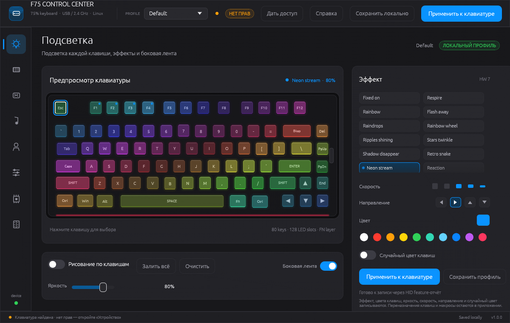

# F75 Control Center

Свободная программа для Linux, которая заменяет фирменное приложение AULA F75.
Она показывает клавиатуру, меняет подсветку, назначение клавиш, макросы и
профили, а также умеет записывать выбранный эффект прямо в клавиатуру.

Всё хранится на компьютере: аккаунта, облака и отправки данных в сеть нет.
Исходный код и свежие версии — на GitHub:
<https://github.com/pbolkhovitin/aula-f75-linux>.

> Это независимая реализация. Она не связана с AULA. Названия AULA и F75
> принадлежат их владельцам. Оригинальный установщик использовался только для
> изучения протокола; чужие логотипы, фотографии и шрифты в программу не
> скопированы.

---

## 1. Что понадобится

- Linux с X11 или Wayland.
- Клавиатура AULA F75, подключённая по USB или через радиоприёмник 2,4 ГГц.
- Установленный Rust (`rustc` и `cargo`) — только чтобы собрать программу.
- Права на чтение и запись устройства `/dev/hidraw*` (как это выдать — в
  разделе 3).

## 2. Сборка и запуск

Склонируйте репозиторий и соберите программу:

```bash
git clone https://github.com/pbolkhovitin/aula-f75-linux.git
cd aula-f75-linux
cargo run --release
```

Или отдельной сборкой:

```bash
cargo build --release
./target/release/f75-control
```

Полезные параметры запуска:

```bash
./target/release/f75-control --page device
./target/release/f75-control --page lighting
./target/release/f75-control --screenshot shots/now.png --page lighting
```

`--page` открывает нужную страницу сразу (`lighting`, `keys`, `macros`,
`music`, `profiles`, `settings`, `device`, `log`, `docs`). `--screenshot` рисует один
кадр без окна и сохраняет PNG — удобно для проверки, что интерфейс
отрисовывается.

## 3. Первое подключение

1. Подключите клавиатуру **по USB** — так надёжнее всего. Радиоприёмник тоже
   подходит для чтения, но запись по USB стабильнее.
2. Нажмите на клавиатуре **FN + W**, чтобы включить режим Windows. В других
   режимах фирменный протокол может не отвечать.
3. Нажмите любую клавишу, чтобы разбудить клавиатуру.
4. Закройте фирменную программу AULA, если она запущена.
5. Откройте страницу **Устройство**. Программа сама проверит доступ и
   покажет найденные узлы: `управление` — тот, через который меняются
   настройки, `клавиатура` — обычный ввод.
6. Если написано **НЕТ ПРАВ**, это не ошибка драйвера и не поломка
   клавиатуры: Linux по умолчанию разрешает открывать `/dev/hidraw*` только
   root. Нажмите **Дать доступ сейчас** — система один раз спросит пароль
   администратора в своём окне, и программа запишет правило с вашей группой.

### Доступ к клавиатуре (ошибка «os error 13»)

Сообщение вида `/dev/hidraw6: open failed: Permission denied (os error 13)`
означает ровно одно: клавиатура найдена, но у программы нет прав открыть
файл устройства. Это лечится правилом udev, а не переустановкой драйвера.

**Почему прежняя команда не помогла.** Старое правило лежало в
`/etc/udev/rules.d/99-f75.rules`. udev читает файлы по порядку, а ACL по тегу
`uaccess` раздаёт `73-seat-late.rules` — то есть файл `99-…` обрабатывается
позже, тег выставляется, но ACL уже никто не создаёт. Поэтому `udevadm info`
показывал `TAGS=:uaccess:seat:`, а `getfacl` — только `user::rw-`,
`group::rw-`, `other::---`: узел оставался `root:root` с правами `0660`.
Новое правило записывается в `/etc/udev/rules.d/70-f75.rules` (до `73-…`),
удаляет старый `99-f75.rules` и вдобавок указывает `GROUP="<ваша группа>"`,
чтобы доступ не зависел от ACL.

Нажмите на странице **Устройство** кнопку **Дать доступ сейчас**. Программа:

- сохраняет скрипт `~/.local/share/f75-control/fix-access.sh`;
- запускает его через `pkexec` — пароль вводится в системном окне, программа
  его не видит и не хранит;
- перезагружает правила udev и применяет их к hidraw сразу, без перезагрузки.

Если системное окно с паролем не появилось, раскройте **Показать команду для
терминала**, скопируйте одну строку, вставьте через **Ctrl+Shift+V** и нажмите
Enter. Кнопка **Сохранить скриптом** кладёт тот же текст в
`~/.local/share/f75-control/fix-access.sh`; запустить его можно командой
`sudo sh ~/.local/share/f75-control/fix-access.sh`.

Затем нажмите **Проверить доступ**. Должно появиться **ГОТОВО**. Запускать
саму программу через `sudo` не нужно и не рекомендуется.

У радиоприёмника два узла hidraw. Запись идёт только в узел `управление`;
узел `клавиатура` служит для обычного ввода. **Что проверено на этой машине:**
приёмник отвечает на 1032-байтовое чтение, но запрос настроек
`[06 83 B6]` завершается таймаутом примерно через 5,1 секунды. Поэтому запись
по радиоканалу сейчас не проходит — это не проблема прав. Подключите
клавиатуру кабелем USB и нажмите **Применить** ещё раз; кнопка **Проверить
связь** на странице «Устройство» показывает то же самое в понятном виде.

## 4. Страницы программы

| Страница | Что делает | Пишет в клавиатуру? |
|---|---|---|
| **Подсветка** | Эффект, яркость, скорость, цвет, рисование по клавишам, боковая лента | Только по кнопке «Применить»: эффект, цвета клавиш, яркость, скорость |
| **Назначение клавиш** | Переназначение клавиш на основном слое, медиа‑клавиши и кнопки мыши | Да, при «Применить»: только изменённые клавиши основного слоя; слой FN пока остаётся в профиле |
| **Макросы** | Запись последовательностей, паузы, триггер, число повторов | Да, при «Применить»: макросы загружаются и привязываются к F9–F12 |
| **Музыка** | 11 режимов и чувствительность, живой предпросмотр | Нет, режим сохраняется в приложении |
| **Профили** | Пять локальных слотов, импорт и экспорт JSON | Нет |
| **Настройки** | Язык, сон, антидребезг, автозапуск, журнал, сброс | Нет |
| **Устройство** | Идентификация, USB-адреса, поиск, применение, правило доступа | Только по кнопке «Применить подсветку» |
| **Журнал** | Что делала программа, ошибки, поиск, копирование и отчёт | Нет |
| **Документация** | Краткая справка и поиск неисправностей | Нет |



## 5. Как применить настройки к клавиатуре

В программе две разные кнопки:

- **Сохранить локально** — записывает профиль в файл на компьютере. На
  клавиатуре ничего не меняется.
- **Применить к клавиатуре** (вверху окна, на странице «Подсветка» и на
  странице «Устройство») — отправляет настройки в само устройство.

Применение повторяет порядок фирменного драйвера (`FUN_00489080`):

1. **Клавиши и макросы.** Если вы что-то переназначили или создали макрос,
   программа сначала читает из клавиатуры текущую 1024-байтовую матрицу
   клавиш (`84 D4`), накладывает только изменённые клавиши и отправляет
   буфер макросов четырьмя частями по 1024 байта (`05 DC/E0/E4/E8`), затем
   матрицу обратно (`04 D4`). Нетронутые клавиши сохраняют заводское
   действие, потому что запись идёт поверх прочитанного.
2. **Профиль подсветки.** Программа читает 254-байтовый профиль (`83 B6`),
   меняет номер эффекта, флаг своей цветовой матрицы и по два байта на
   каждую клавишу, затем сохраняет профиль (`03 B6`).
3. **Цвета клавиш.** Для эффекта «Self-define» дополнительно отправляется
   1890-байтовая матрица цветов двумя посылками.

Между шагами выдерживаются задержки оригинала: 30 мс перед сохранением
профиля, 50 мс после каждой части макросов и матрицы клавиш, 30/50 мс вокруг
цветовых посылок и 500 мс в конце. Фирменная программа делает всё это только
по кнопке Save.

Что **не** записывается в клавиатуру:

- действия из групп «Команды» и «Комбинации» — их коды не восстановлены,
  такие назначения пропускаются с предупреждением в журнале;
- слой FN — он хранится в профиле на компьютере, на клавиатуру уходит только
  основной слой;
- макросы с триггером, отличным от F9–F12: других триггеров в
  восстановленном формате нет;
- прошивка.

Эффект, цвета клавиш, яркость, скорость, направление и случайный цвет
записываются в профиль клавиатуры: два байта на клавишу по формуле из
`FUN_00488FA0` (см. `MECHANICS.md`). Общий бюджет макросов — 4096 байт,
поэтому слишком большая библиотека не поместится: программа сообщит об этом
до отправки.

## 6. Где хранятся данные

| Что | Где |
|---|---|
| Текущее состояние и настройки | `~/.config/f75-control/state.json` |
| Профили для импорта и экспорта | `~/.config/f75-control/profiles/*.json` |
| Журнал работы и ошибок | `~/.config/f75-control/Log.txt` |
| Отчёт для пересылки | `~/.config/f75-control/diagnostics.txt` |
| Автозапуск | `~/.config/autostart/f75-control.desktop` |

Программе не нужна сеть. Профили — обычные текстовые JSON-файлы, их можно
копировать и переносить между компьютерами.

### Журнал и диагностика

Страница **Журнал** показывает, что программа делала и что не получилось:
подключение, проверку прав, чтение профиля, применение подсветки и ошибки.
По умолчанию пишутся ошибки, предупреждения и основные шаги; уровень можно
сменить на «Ошибки», «Обычный» или «Отладка» на той же странице или в
**Настройках**.

- **Копировать** кладёт видимые строки в буфер обмена.
- **Отчёт** сохраняет `diagnostics.txt` рядом с журналом: версия, система,
  счётчики и все строки. Этот файл удобно переслать, если нужна помощь.
- **Папка** открывает каталог с журналом.
- **Очистить** стирает журнал после подтверждения.
- В памяти хранятся последние 2000 строк; файл `Log.txt` очищается при
  запуске, а при размере больше 1 МиБ старый файл становится `Log.1.txt`.

Фирменная программа ведёт похожий `Log.txt` на рабочем столе и включает его
только при `Debug` больше 1 в `Cfg.ini`. Здесь журнал включён сразу, чтобы
ошибку можно было разобрать после закрытия окна. Подробности и адреса
функций — в `MECHANICS.md`.

## 7. Если что-то не работает

| Симптом | Что проверить |
|---|---|
| Внизу написано «No keyboard» | USB-кабель, пробуждение клавиши, FN + W, кнопка «Проверить USB», `ls /sys/class/hidraw` |
| «Permission denied» / «os error 13» при применении | Это не ошибка драйвера: нажмите «Скопировать команду» на странице «Устройство», выполните её, переподключите клавиатуру и нажмите «Проверить доступ» |
| Применение прошло, но подсветка не изменилась | Режим Windows (FN + W), клавиатура не спит, фирменная программа закрыта, подключение по USB |
| Яркость и скорость не применяются | Нажмите «Применить к клавиатуре», разбудите клавиатуру и включите режим Windows (FN+W): значения пишутся в профиль устройства |
| Макросы и переназначения не работают на клавиатуре | Так и задумано: они пока не загружаются в устройство |
| Радиоприёмник не виден | В правиле udev должны быть оба адреса, `3554:fa09` и `258a:010c`; для записи используйте USB |
| Окно не открывается | Проверьте `--screenshot`: если PNG создаётся, проблема в графическом окружении, а не в программе |
| Непонятно, почему применение не сработало | Откройте **Журнал**: там время, модуль и точная ошибка; кнопка **Отчёт** сохраняет всё в один файл |

## 8. Что пока не реализовано

- Действия «Команды» и «Комбинации», а также особые пункты вроде
  «Двойной клик»: коды этих действий не восстановлены, поэтому они остаются
  в профиле и пропускаются при записи.
- Переназначения слоя FN — слой хранится в профиле, но в матрицу клавиш
  попадает только основной слой.
- Остальные триггеры макросов, кроме F9–F12.
- Смысл глобальных байтов профиля `7..0x13` неизвестен; настраиваемые
  яркость, скорость, направление и случайный цвет пишутся в двухбайтовой
  таблице клавиш и работают.
- Прошивка, аккаунт, облачные профили и онлайн-обновление — фирменный сервер
  эта программа не подменяет.
- Боковая лента показана упрощённо (включена/выключена): карта её светодиодов
  не разобрана полностью.
- Музыкальный режим — предпросмотр и сохранение выбора; сама клавиатура
  реагирует на звук по своему алгоритму.

## 9. Для разработчика

| Файл | Назначение |
|---|---|
| `src/main.rs` | Окно, верхняя панель, боковое меню, сохранение состояния |
| `src/pages.rs` | Все страницы интерфейса |
| `src/model.rs` | Константы протокола, профили, макросы, состояние |
| `src/device.rs` | Поиск hidraw-устройства и запись подсветки |
| `src/log.rs` | Журнал в памяти и файле, уровни, отчёт, перехват паники |
| `src/keyboard.rs` | Отрисовка клавиатуры и попадания по клавишам |
| `src/theme.rs` | Цвета, шрифты, кнопки и иконки |
| `src/headless.rs` | Отрисовка PNG без окна (`--screenshot`) |
| `MECHANICS.md` | Подробный разбор протокола, адресов функций и посылок |
| `mechanics.json` | 157 значений с указанием источника или пометкой «оценено» |

Тесты и проверка перед сдачей:

```bash
cargo test
cargo build --release
./target/release/f75-control --screenshot shots/now.png --page lighting
./target/release/f75-control --screenshot shots/docs.png --page docs
```

`cargo test` проверяет разбор координат клавиш, формулу профиля, кодирование
макросов, наложение матрицы клавиш и текст правила udev — без подключённой
клавиатуры.

Технические подробности — в `MECHANICS.md`. Там описаны 520-байтовый
конфигурационный кадр, 1032-байтовый кадр подсветки, чтение и сохранение
254-байтового профиля, тайминги и ограничения.

## 10. Благодарности и границы

Программа написана по результатам изучения установщика и вендорского
драйвера. Все иконки, логотип и рисунок клавиатуры созданы в коде, сторонние
изображения и шрифты не используются. Названия эффектов и режимов — подписи
интерфейса, а не строки, извлечённые из исполняемого файла.

## 11. Лицензия и участие

Код распространяется по лицензии MIT (файл `LICENSE`): программу можно
свободно использовать, изменять и распространять при сохранении уведомления
об авторских правах. Это не официальный продукт AULA; название клавиатуры
используется только для описания совместимости.

Если вы нашли ошибку или хотите добавить свою модель клавиатуры:

1. Откройте **Журнал** и сохраните отчёт — там версия, система, узлы hidraw и
   точная ошибка.
2. Создайте issue в репозитории и приложите отчёт.
3. Для новой модели нужен её `KB.ini` из установщика: по нему задаются
   раскладка, светодиоды и таблица эффектов.

Протокол, адреса функций и все восстановленные значения описаны в
`MECHANICS.md`; `mechanics.json` содержит те же числа в машиночитаемом виде.
